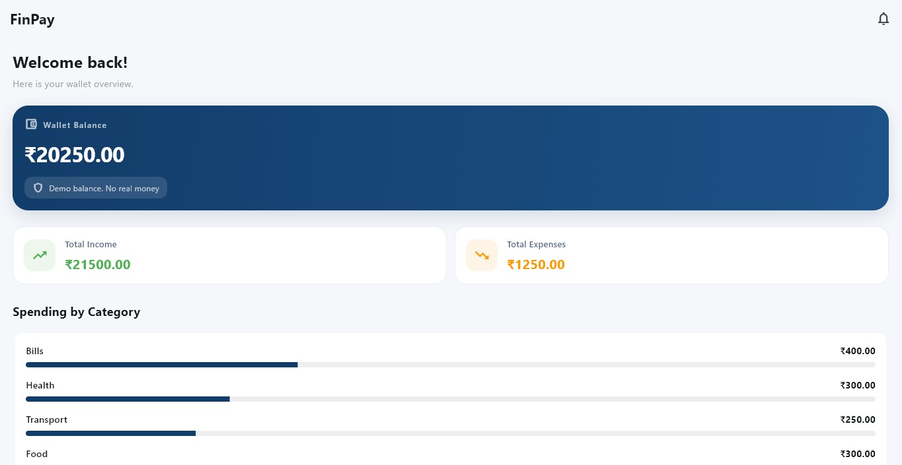

# FinPay — Flutter Wallet Demo

FinPay is a fintech-inspired wallet application built with **Flutter and Dart**. It demonstrates modern mobile UI development, reactive state management, wallet balance calculations, and transaction management.

This project is being developed as a Flutter portfolio project to showcase practical app architecture, UI design, and application logic.

## App Preview



## Features

- **Wallet Dashboard** — View the current demo wallet balance.
- **Add Money** — Add a simulated amount to the wallet with input validation.
- **Expense Management** — Record expenses with a title, amount, and category.
- **Transaction History** — View and manage recorded transactions.
- **Edit and Delete Transactions** — Update or remove transactions with balance validation.
- **Category-wise Spending** — View expense breakdowns by category.
- **Search and Filters** — Find transactions using available search, filter, sorting, and date-filtering options.
- **Recent Transactions** — View the latest five transactions on the dashboard.
- **Persistent Local Data** — Store wallet and transaction data locally using GetStorage.
- **Responsive UI** — Dashboard layouts adapt to desktop and mobile screen sizes.

## Tech Stack

- **Flutter** — Cross-platform UI framework
- **Dart** — Programming language
- **GetX** — State management and application bindings
- **GetStorage** — Local data persistence
- **Material Design 3** — UI components and styling

## Project Structure

```text
lib/
├── app/
│   └── app.dart
├── core/
├── features/
│   ├── dashboard/
│   │   ├── bindings/
│   │   ├── controllers/
│   │   └── views/
│   ├── scanner/
│   └── transactions/
└── main.dart

test/
└── features/
    └── dashboard/
        └── controllers/
            └── dashboard_controller_test.dart
```

## Getting Started

### Prerequisites

- Flutter SDK
- Dart SDK
- VS Code or Android Studio

### Run Locally

```bash
git clone https://github.com/Ashwinikhodake/finpay-flutter.git
cd finpay-flutter
flutter pub get
flutter run
```

### Run Tests

Execute the automated test suite with:

```bash
flutter test
```

**Current test status:** All 20 tests passed in the latest verified run.

## Project Status

FinPay is an ongoing portfolio project. Its current focus is improving the user experience, maintaining reliable transaction logic, and preparing the application for portfolio presentation.

## Disclaimer

**FinPay is a demo application.** Wallet balances and transactions are simulated and stored locally. The application does not connect to a real bank account or process real payments.
